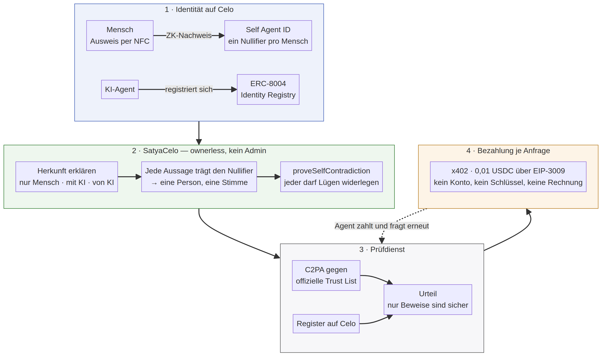

# Satya auf Celo

**Herkunft von Inhalten als öffentliches Register – jede Aussage an genau einen Menschen gebunden.**

*satya* (सत्य) ist Sanskrit für Wahrheit – nicht als Behauptung, sondern als etwas, für das jemand einsteht.

Eingereicht für *Agents on Open Rails* (Celo). Live auf Celo Sepolia, verifiziert, mit echten Transaktionen.

| | |
|---|---|
| Vertrag | [`0x58d5f2c2ac866D7828b7e2Bf1A3542C3536c3001`](https://celo-sepolia.blockscout.com/address/0x58d5f2c2ac866D7828b7e2Bf1A3542C3536c3001) (Quellcode verifiziert) |
| Netz | Celo Sepolia (11142220) |
| Bezahlter Endpunkt | `POST /api/x402/verify` · 0,01 USDC je Anfrage |
| Agentenprofil | `/.well-known/agent.json`, ERC-8004 agentId **453** |
| Tests | 29 Vertragstests + 20 Python-Tests, alle grün |

---

## 1. Das Problem, ehrlich benannt

Die Frage „Hat eine KI das geschrieben?" lässt sich **nicht zuverlässig am Inhalt selbst beantworten**. Das ist kein Werkzeugmangel, sondern ein bewiesenes Ergebnis: Sadasivan et al. zeigen, dass die Erkennbarkeit mit besseren Modellen gegen den Zufall konvergiert; Zhang et al. zeigen, dass starke Wasserzeichen unter realistischen Annahmen nicht existieren können. Jeder Detektor, der ein Urteil aus Stil oder Statistik ableitet, produziert Fehlalarme – und trifft dabei systematisch Nicht-Muttersprachler.

Gleichzeitig greift ab August 2026 Artikel 50 der KI-Verordnung: KI-Anbieter müssen ihre Ausgaben maschinenlesbar kennzeichnen. Es entsteht also eine Welt, in der **Herkunft erklärt wird**, statt erraten zu werden.

Satya zieht daraus die Konsequenz:

> Nicht raten, wer etwas geschrieben hat – sondern festhalten, **wer sich dafür verbürgt**, und was passiert, wenn jemand lügt.

## 2. Was auf Celo neu ist

Die bestehende Prüfschicht (C2PA gegen die offizielle Trust List, Metadaten, Wasserzeichen, Siegel) beantwortet: *Was behauptet die Datei über sich selbst?* Sie beantwortet **nicht**: *Wer haftet dafür, und ist das derselbe, der gestern das Gegenteil sagte?*

Genau das löst der Vertrag auf Celo – mit drei Eigenschaften, die ohne Celo nicht möglich wären:

### a) Eine Person, eine Stimme – nicht eine Wallet, eine Stimme

Jede Erklärung wird über **Self Agent ID** an den ZK-Nullifier eines echten Ausweises gebunden. Wallets sind beliebig vermehrbar, Menschen nicht.

Das ist kein theoretisches Argument. Live auf Celo Sepolia ausgelesen:

| Self agentId | Wallet | Nullifier |
|---|---|---|
| 1 | `0x5517…e47a` | `105325254507…0982` |
| 2 | `0x5E25…Ab95` | **derselbe** |
| 3 | `0x5E25…Ab95` | **derselbe** |

Drei Agenten, zwei Wallets, **ein Mensch**. In einem naiven Register hätte diese Person drei Stimmen. Satya zählt eine – `declareAsHuman` lehnt die zweite Erklärung desselben Nullifiers zum selben Inhalt ab.

### b) Lügen sind widerlegbar – von jedem, ohne Betreiber

Wenn dieselbe Person über denselben Inhalt zwei unvereinbare Aussagen macht („von mir allein" und „von KI erzeugt"), kann **jeder Beliebige** das beweisen:

```solidity
proveSelfContradiction(contentHash, indexA, indexB)
```

Der Vertrag prüft nur Nullifier-Gleichheit und Unvereinbarkeit. Beide Aussagen werden dauerhaft als `disputed` markiert; `provenFraud` wird gesetzt. Es gibt keinen Admin, der das entscheidet, und keinen, der es verhindern kann. **Der Vertrag hat keinen Eigentümer** – nach dem Deployment gibt es keine privilegierte Rolle mehr.

Das verwandelt ein Vertrauensproblem in ein Rechenproblem: Eine Lüge bleibt billig, aber sie wird **dauerhaft nachweisbar**, und das Register vergisst sie nie.

### c) Der Dienst bezahlt sich selbst – ohne Konto

Ein Agent, der wissen will, ob er einer Datei trauen kann, braucht keinen Account und keinen API-Schlüssel:

```
POST /api/x402/verify          → 402, Preis: 0,01 USDC auf celo-sepolia
POST /api/x402/verify          → 200 + Befund + Quittung
  X-PAYMENT: <signierte EIP-3009-Autorisierung>
```

Echter Durchlauf, real abgerechnet:

```
402 Payment Required — 0.01 USDC on celo-sepolia
Guthaben vorher: 19.980000 USDC
→ 200 OK
   verdict  KI_NACHGEWIESEN (sicher)
   proof    C2PA: Signiertes Manifest von OpenAI OpCo, LLC …
   register AI_GENERATED via AGENT_8004
   Zahlung  settled=True
            0xc3f8a7eebc67969f51e6c8b43e329b8e91fa3e118413fc8b4ea76d8b65c8e16b
Guthaben nachher: 19.970000 USDC
```

## 3. Architektur



Der Vertrag spricht mit zwei bestehenden Celo-Registern und besitzt selbst nichts:

| Rolle | Vertrag auf Celo Sepolia |
|---|---|
| Menschlichkeit + Agentenbindung | Self Agent ID `0x043DaCac8b0771DD5b444bCC88f2f8BBDBEdd379` |
| Agentenidentität | ERC-8004 `0x8004A818BFB912233c491871b3d84c89A494BD9e` |
| Bezahlung | x402-Facilitator `api.x402.sepolia.celo.org`, USDC `0x01C5C012…BC44E` |

### Drei Wege, sich zu erklären

| Funktion | Wer | Was der Vertrag prüft |
|---|---|---|
| `declareAsHuman` | verifizierter Mensch | Self-Nachweis vorhanden **und** frisch; Nullifier noch nicht für diesen Inhalt verbraucht |
| `declareAsAgent` | Agent eines verifizierten Menschen | Agent gehört dem Aufrufer; Mensch dahinter wird mitgeführt; darf **nie** „nur Mensch" behaupten |
| `declareAsAgent8004` | reiner ERC-8004-Agent | Wallet stimmt mit der Registry überein; ohne Mensch dahinter, daher ohne Stimmrecht bei Widersprüchen |

Dazu `anchorSeal`: eine EIP-712-signierte Erklärung, die **ein Dritter** einreichen und bezahlen kann. Der Mensch signiert offline, der Dienst trägt die Gaskosten – wichtig, weil sonst jeder Zeuge erst CELO besorgen müsste.

### Kosten

| Aufruf | Gas | Auf Celo real |
|---|---|---|
| `declareAsHuman` | ~153 000 | Bruchteile eines Cents |
| `declareAsAgent8004` | 129 331 ([Tx](https://celo-sepolia.blockscout.com/tx/0x77cc7734337f34d7bb6d9739f6e09c6e5164e6fa4f887442d0d96030fedddfa8)) | gemessen |
| `proveSelfContradiction` | ~27 000 | Betrugsaufdeckung ist billiger als die Lüge |
| Vertragsgröße | 10 016 Byte | weit unter dem Limit |

Dass Betrugsaufdeckung **fünfmal günstiger** ist als die Falschaussage, ist Absicht: Wer lügt, zahlt mehr als der, der die Lüge widerlegt.

## 4. Was bewiesen ist – und was nicht

Satya unterscheidet strikt zwischen **Beweis** und **Indiz**, und sagt „weiß ich nicht", wenn es nichts weiß.

| Stufe | Beispiel | Darf entscheiden? |
|---|---|---|
| **Beweis** | C2PA-Signatur, über die offizielle Trust List verifiziert; Erklärung eines verifizierten Menschen | ja |
| **Indiz** | unsignierte Metadaten, offene Wasserzeichen, Textähnlichkeit | nein, wird nur angezeigt |
| **Unbestimmt** | nichts davon vorhanden | ehrliche Antwort |

Gemessen an einem Testkorpus von 22 Fällen mit bekannter Wahrheit:

| | Satya | naiver Indizien-Detektor |
|---|---|---|
| trifft überhaupt eine Aussage | 9 von 22 (41 %) | 16 von 22 |
| davon falsch | **1** | **5** |
| davon unschuldige als KI beschuldigt | 0 | 3 |

Der naive Detektor antwortet öfter und liegt dabei fünfmal daneben – darunter dreimal gegen einen echten Menschen, etwa beim „echten Foto mit nachträglich eingefügten Stable-Diffusion-Parametern". Satya schweigt in diesen Fällen.

**Der eine Fehler ist der interessante.** Fall 22: Mallory ist ein verifizierter Mensch und versiegelt einen KI-Text wahrheitswidrig als „ohne KI". Nichts an der Datei verrät das. Satya urteilt sicher und falsch – eine konsistente Lüge einer haftbaren Person ist durch Prüfung des Inhalts nicht aufzudecken.

Genau hier greift Celo. Sobald irgendjemand eine zweite, unvereinbare Aussage derselben Person findet und `proveSelfContradiction` aufruft, markiert der Vertrag beide Aussagen als widerlegt. Dieselbe Messung danach:

| | vorher | nach Aufdeckung |
|---|---|---|
| sichere Urteile | 9 | 9 |
| davon falsch | 1 | **0** |

Das Register korrigiert sich selbst, ohne dass ein Betreiber eingreift – und der naive Detektor bleibt bei seinen fünf Fehlern, weil ihm niemand widersprechen kann.

**Grenzen, offen gesagt:**

- Wer eine Datei ohne jeden Nachweis hochlädt, bekommt „unbestimmt". Das ist das Richtige, aber keine Antwort auf die Frage, die viele stellen.
- Ein verifizierter Mensch, der **konsistent** lügt, bleibt unentdeckt, solange er sich nie widerspricht. Satya macht Lügen nachweisbar, nicht unmöglich. Die Aufdeckung setzt voraus, dass jemand die zweite, unvereinbare Aussage findet.
- Die Abdeckung von 41 % ist niedrig. Das ist der Preis dafür, nie zu raten – und sie steigt genau in dem Maß, wie Artikel 50 die Kennzeichnung zur Pflicht macht.
- Self Agent ID ist eine Vertrauensannahme. Fällt sie, fällt die Personenbindung.
- Celo Sepolia ist ein Testnetz; die Self-Nachweise dort stammen aus Mock-Dokumenten.
- Die x402-Abrechnung läuft derzeit über den direkten EIP-3009-Pfad, weil der Settlement-Endpunkt des Celo-Facilitators einen Dashboard-Schlüssel verlangt, der eine Wallet-Signatur im Browser erfordert. Der Verifikationspfad läuft über den Facilitator.

## 5. Selbst ausprobieren

```bash
git clone <repo> && cd satya
pip install -r requirements.txt

# Register live auf Celo abfragen – braucht nichts weiter
curl -s https://<host>/api/celo/herkunft/0xd7c2d77c62016c1038466eb73df60ae1a01ba8ba2755510bdcbedbeb1dab2364

# Vollständiger Ablauf gegen die Live-Chain
python3 demo/celo_flow.py

# Als Agent eine Prüfung kaufen (braucht Test-USDC)
python3 demo/x402_client.py --url https://<host>

# Dienst lokal starten (Celo + lokales Demo-Register)
./demo/serve.sh 8000
```

Vertragstests:

```bash
cd contracts && forge test     # 46 Tests, davon 29 für SatyaCelo
```

## 6. Warum Celo

Nicht austauschbar – drei Dinge gibt es so nur hier:

1. **Self Agent ID** ist der einzige produktive Proof-of-Personhood, der Agenten direkt an einen eindeutigen Menschen bindet. Ohne ihn ist „eine Person, eine Stimme" nicht durchsetzbar.
2. **Gas, das niemanden ausschließt.** Ein Register, in dem Zeugen aussagen, funktioniert nur, wenn Aussagen Bruchteile eines Cents kosten.
3. **x402 mit nativem USDC**, damit ein Agent einen Dienst bezahlen kann, ohne vorher Mensch zu werden.

---

### Quellen

- Sadasivan et al., *Can AI-Generated Text be Reliably Detected?* (arXiv 2303.11156)
- Zhang et al., *Watermarks in the Sand* (arXiv 2311.04378)
- Verordnung (EU) 2024/1689 (KI-Verordnung), Artikel 50
- C2PA-Spezifikation 2.2 und offizielle Trust List (c2pa.org)
- Celo-Dokumentation: Self Agent ID, ERC-8004, x402
