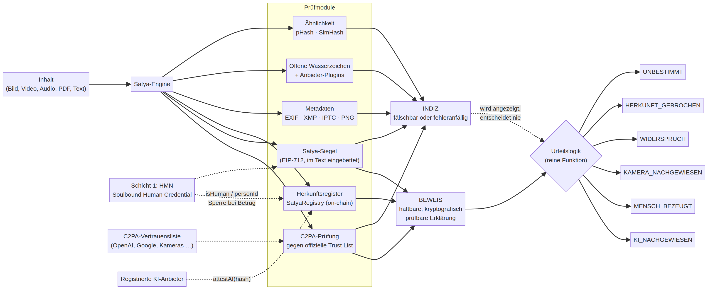

# Satya – Herkunft prüfen statt raten

**Prototyp · Stand 5. Oktober 2026**

## 1. Die ehrliche Antwort zuerst

Du wolltest ein System, das **todsicher** sagt, ob ein Inhalt von irgendeiner KI stammt. So wie die Frage gestellt ist, kann das kein System leisten, auch Satya nicht. Das liegt nicht an fehlender Rechenleistung oder schlechter Programmierung, sondern ist in der Forschung belegt. Ein Text, den ein Sprachmodell geschrieben und danach ein zweites Modell umformuliert hat, unterscheidet sich statistisch nicht verlässlich von einem menschlichen Text [1]. Robuste Wasserzeichen für generative Modelle sind unter realistischen Annahmen nachweislich unmöglich [2]. Lokal betriebene Open-Source-Modelle markieren ihre Ausgaben überhaupt nicht. Jedes Werkzeug, das trotzdem „98 % KI“ meldet, rät. Ein Detektor, der falsch liegt, erzeugt eine **falsche Beschuldigung mit scheinbarer Gewissheit**. Ein fehlender Herkunftsnachweis bedeutet dagegen nur, dass eine Information fehlt [3].

Satya stellt die Frage deshalb so, dass sie sich sicher beantworten lässt. Statt zu fragen, ob der Inhalt nach KI aussieht, fragt Satya: **Wer hat überprüfbar erklärt, wie dieser Inhalt entstanden ist, und haftet dafür?** Diese Frage beantwortet Satya kryptografisch exakt. Wenn es keinen solchen Nachweis gibt, sagt Satya ausdrücklich „unbestimmt“ und rät nicht.

> **Kerngarantie:** Satya fällt ein sicheres Urteil nur, wenn ein kryptografisch überprüfbarer Nachweis einer identifizierbaren, haftbaren Stelle vorliegt. Indizien wie Metadaten, Wasserzeichen oder Ähnlichkeit werden angezeigt, entscheiden aber nie. Diese Garantie ist als reine Funktion implementiert und mit 8.000 zufällig erzeugten Fällen durch Eigenschaftstests geprüft.

Mit dieser Umstellung wird die Abdeckung schrittweise größer: OpenAI und Google signieren ihre Bilder bereits heute nach C2PA, Kameras wie das Pixel 10 signieren jedes Foto [4], und seit dem 2. August 2026 müssen Anbieter generativer KI in der EU ihre Ausgaben maschinenlesbar kennzeichnen [5]. Satya wertet genau diese Nachweise aus und verbindet sie mit der Menschen-Schicht (HMN). Dadurch können **verifizierte Menschen** ihre Inhalte haftbar als „ohne KI erstellt“ kennzeichnen, und eine Lüge führt zur dauerhaften Sperre der Person.

## 2. Warum KI-Erkennung nicht todsicher sein kann

| Ansatz | Was die Forschung zeigt | Folge für Satya |
|---|---|---|
| Stil- und Statistik-Detektoren für Text | Umformulieren bricht Detektoren; je besser die Modelle werden, desto näher kommt die Fehlerrate dem Zufall [1]. Detektoren stufen Texte von Nicht-Muttersprachlern überdurchschnittlich oft als KI ein [6]. OpenAI hat seinen eigenen Klassifikator 2023 wegen zu geringer Genauigkeit eingestellt. | Wird **nicht verwendet**, auch nicht als Indiz. |
| Wasserzeichen im Text (KGW, Unigram, SynthID-Text) | Nach Paraphrase werden 100 %, 100 % und 98,3 % der Wasserzeichen entfernt. SynthID markierte 5,4 % umformulierter menschlicher Kontrolltexte fälschlich. Erfüllt höchstens 2 von 5 Daubert-Kriterien für gerichtliche Beweise [7]. | Nur als **Indiz** über Anbieter-Plugins. |
| Wasserzeichen in Bildern | Starke Wasserzeichen sind unter natürlichen Annahmen unmöglich [2]. Offene Verfahren (z. B. Stable Diffusion) lassen sich von jedem einbetten und entfernen. | Nur als **Indiz**, mit strenger Schwelle (siehe Abschnitt 6). |
| Unsignierte Metadaten (EXIF, XMP, PNG) | Kann jeder setzen oder löschen. | Nur als **Indiz**. |
| C2PA Content Credentials | Kryptografisch an den Inhalt gebunden und über eine Vertrauensliste prüfbar. Schwächen bestehen bei Zeitstempeln, Widerruf und uneinheitlichen Validatoren [8]. Metadaten gehen beim Re-Encoding oder bei Screenshots verloren. | **Beweis**, aber nur bei vertrauenswürdiger Kette und intakter Bindung. |

OpenAI schreibt über sein eigenes Prüfwerkzeug: Wenn kein Herkunftsnachweis gefunden wird, „the tool will not make a definitive conclusion“ [9]. Satya folgt demselben Prinzip konsequent für alle Quellen.

## 3. Was Satya sicher sagen kann: sechs Urteile

| Urteil | Sicher? | Bedeutung | Typische Quelle |
|---|---|---|---|
| `KI_NACHGEWIESEN` | ja | Eine haftbare Stelle erklärt überprüfbar eine KI-Beteiligung. | C2PA-Manifest von OpenAI/Google, Registereintrag eines KI-Anbieters, ehrliches Siegel „mit KI-Unterstützung“ |
| `MENSCH_BEZEUGT` | ja | Ein verifizierter Mensch (HMN-Credential) erklärt haftbar „ohne KI erstellt“. | Satya-Siegel oder Registereintrag |
| `KAMERA_NACHGEWIESEN` | ja | Ein vertrauenswürdiges Aufnahmegerät hat die Aufnahme signiert, ohne KI-Bearbeitung. | C2PA `digitalCapture` |
| `WIDERSPRUCH` | nein | Gültige Nachweise widersprechen sich, mindestens eine Stelle lügt. | KI-Anbieter und Mensch zum selben Inhalt |
| `HERKUNFT_GEBROCHEN` | nein | Ein Nachweis ist vorhanden, der Inhalt wurde aber danach verändert. | Hash-Abweichung bei C2PA oder Siegel |
| `UNBESTIMMT` | nein | Kein überprüfbarer Nachweis vorhanden. Ehrliche Antwort statt Raten. | Alles andere |

Wichtig ist der genaue Wortlaut: `MENSCH_BEZEUGT` bedeutet „ein verifizierter Mensch steht mit seiner Identität dafür ein“, nicht „garantiert ohne KI“. Ein Nachweis belegt, **wer** etwas erklärt, nicht, ob die Erklärung wahr ist. Falsche Erklärungen lassen sich aber einer Person zuordnen und werden sanktioniert. Die Auswertung in Abschnitt 6 zeigt genau dieses Restrisiko.

## 4. Architektur

Satya besteht aus einer Prüf-Engine mit sechs Modulen, einem On-Chain-Herkunftsregister und einer deterministischen Urteilslogik. Jedes Modul liefert Befunde in genau einer von drei Stufen (**Beweis**, **Indiz**, **Hinweis**). Die Urteilslogik betrachtet für das Urteil ausschließlich Beweise.

| Modul | Prüft | Stufe |
|---|---|---|
| C2PA-Prüfung | Signatur, Hash-Bindung und Zertifikatskette gegen die offizielle C2PA-Vertrauensliste (30 Anker, 22 TSA-Anker, Stand 2.10.2026) sowie deklarierte Quelltypen nach IPTC (`trainedAlgorithmicMedia`, `compositeWithTrainedAlgorithmicMedia`, `digitalCapture` u. a.) | Beweis bei vertrauenswürdiger Kette, sonst Indiz |
| Satya-Siegel | EIP-712-Signatur einer Wallet über SHA-256 des normalisierten Inhalts und die KI-Angabe; Prüfung des HMN-Credentials über das Register (EOA und ERC-1271) | Beweis nur bei gültigem HMN-Credential |
| Herkunftsregister | On-Chain-Erklärungen verifizierter Menschen und registrierter KI-Anbieter zum exakten Inhalts-Hash, inklusive Widerruf und Betrugsmarkierung | Beweis |
| Metadaten | EXIF, XMP, IPTC, PNG-Textfelder mit Generatornamen und KI-Parametern | Indiz |
| Offene Wasserzeichen | Stable-Diffusion-Wasserzeichen (DWT-DCT); Schnittstelle für Anbieter-Detektoren (SynthID, OpenAI-Verify-API) | Indiz |
| Ähnlichkeit | Wahrnehmungs-Hash (pHash, Bilder) und SimHash (Text) gegen Registereinträge | Indiz |

**Texte** werden vor dem Hashen normalisiert (Unicode NFC, Zeilenenden, Leerraum, unsichtbare Zeichen), damit Kopieren und Einfügen das Siegel nicht bricht. Ein Siegel wird als Block an den Text angehängt und übersteht so Copy & Paste, E-Mail und Chat. Schon die Änderung eines einzigen Wortes bricht es nachweisbar.

## 5. Zusammenspiel mit der Menschen-Schicht (HMN)

Die Menschen-Schicht (HMN) beantwortet die Frage, ob hinter einer Wallet ein einzigartiger, verifizierter Mensch steht. Die Herkunfts-Schicht nutzt diese Antwort für Inhalte. Der Vertrag `SatyaRegistry` fragt bei jeder menschlichen Erklärung `isHuman` und die pseudonyme `personId` des HMN-Credentials ab. Dadurch ergeben sich drei Eigenschaften:

1. **Ein KI-Agent kann kein gültiges „ohne KI“-Siegel ausstellen.** Er kann zwar signieren, besitzt aber kein HMN-Credential. Satya wertet sein Siegel nur als Indiz (Fall 19).
2. **Lügen haben Folgen für die Person, nicht nur für die Wallet.** Markiert die Governance eine Erklärung als Betrug und widerruft der Issuer das Credential mit `fraud = true`, werden **alle** Erklärungen dieser Person ungültig. Eine neue Wallet hilft nicht, weil die `personId` gesperrt bleibt.
3. **Datenschutz:** Im Register stehen nur Inhalts-Hashes, pseudonyme Personen-IDs und die KI-Angabe, nie der Inhalt selbst und keine Klarnamen.

Das Siegeln ist kostenlos und offline möglich. Erst das optionale Verankern auf der Chain kostet Gas (siehe Abschnitt 8).

## 6. Auswertung mit echten KI-Inhalten

Für die Auswertung wurde ein Korpus aus 22 Fällen mit bekannter Wahrheit gebaut. Er enthält **echte** KI-Bilder von OpenAI (gpt-image) und Google (Nano Banana 2) mit deren originalen C2PA-Signaturen, echte KI-Texte von gpt-5-mini, echte Fotos sowie gemeinfreie menschliche Texte (Kafka, Goethe, Grimm). Dazu kommen gezielte Angriffe: gefälschte Signaturen, nachträglich eingebettete Wasserzeichen, gefälschte Generator-Metadaten, ein KI-Agent mit Siegel und eine verifizierte Person, die lügt. Satya kennt die Wahrheit nicht. Zum Vergleich wurde ein **naiver Indizien-Detektor** gemessen, der jedes Indiz als Antwort behandelt, so wie viele verbreitete KI-Detektoren arbeiten.

In Phase 2 wird Mallorys Lüge aufgedeckt: Die Governance markiert ihre widersprüchliche Erklärung als Betrug, und der Issuer sperrt ihr Credential.

| Kennzahl | Satya (Phase 1) | Satya (nach Aufdeckung) | Naiver Indizien-Detektor |
|---|---|---|---|
| Fälle | 22 | 22 | 22 |
| Sichere Urteile bzw. Antworten | 9 | 9 | 16 |
| davon korrekt | 8 | 9 | 11 |
| davon falsch | 1 | 0 | 5 |
| Falsche KI-Beschuldigungen echter menschlicher Inhalte | **0** | **0** | **3** |
| Abdeckung (sichere Urteile / Fälle) | 40,9 % | 40,9 % | – |

| Nr. | Fall | Wahrheit | Satya | Nach Aufdeckung | Naiver Detektor |
|---|---|---|---|---|---|
| 01 | Echtes Bild aus gpt-image (OpenAI), unverändert mit C2PA | KI | KI_NACHGEWIESEN | unverändert | KI |
| 02 | Echtes Bild aus Nano Banana 2 (Google), unverändert mit C2PA | KI | KI_NACHGEWIESEN | unverändert | KI |
| 03 | OpenAI-Bild als JPEG neu gespeichert; Anbieter hat das Original registriert | KI | UNBESTIMMT | unverändert | KI |
| 04 | Google-Bild, nach der Signatur ein Byte verändert | KI | HERKUNFT_GEBROCHEN | unverändert | KI |
| 05 | Google-Bild verkleinert, ohne Metadaten | KI | UNBESTIMMT | unverändert | – |
| 06 | Echtes Foto, von (Demo-)Kamera mit C2PA signiert | Mensch | KAMERA_NACHGEWIESEN | unverändert | Mensch |
| 07 | Echtes Foto ohne Nachweis | Mensch | UNBESTIMMT | unverändert | – |
| 08 | Echtes Foto, Fälscher signiert mit eigener CA als „OpenAI OpCo, LLC“ | Mensch | UNBESTIMMT | unverändert | KI (falsch) |
| 09 | Echtes Foto mit nachträglich eingebettetem SDXL-Wasserzeichen | Mensch | UNBESTIMMT | unverändert | KI (falsch) |
| 10 | Echtes Foto mit eingefügten Stable-Diffusion-Parametern | Mensch | UNBESTIMMT | unverändert | KI (falsch) |
| 11 | Echtes Foto, von Alice (verifiziert) als „ohne KI“ registriert | Mensch | MENSCH_BEZEUGT | unverändert | Mensch |
| 12 | Kafka, mit Alices Siegel „ohne KI“ | Mensch | MENSCH_BEZEUGT | unverändert | Mensch |
| 13 | Wie 12, ein Wort geändert | Mensch | HERKUNFT_GEBROCHEN | unverändert | – |
| 14 | Goethe, von Alice on-chain verankert | Mensch | MENSCH_BEZEUGT | unverändert | Mensch |
| 15 | Grimm ohne Nachweis | Mensch | UNBESTIMMT | unverändert | – |
| 16 | KI-Text, vom Anbieter registriert | KI | KI_NACHGEWIESEN | unverändert | KI |
| 17 | Text 16 von einer KI umformuliert | KI | UNBESTIMMT | unverändert | – |
| 18 | KI-Text ohne Nachweis | KI | UNBESTIMMT | unverändert | – |
| 19 | KI-Text, KI-Agent ohne Credential siegelt „ohne KI“ | KI | UNBESTIMMT | unverändert | Mensch (falsch) |
| 20 | KI-Text vom Anbieter registriert, Mallory verankert „ohne KI“ | KI | WIDERSPRUCH | KI_NACHGEWIESEN | KI |
| 21 | KI-Entwurf, von Alice ehrlich als „mit KI-Unterstützung“ gesiegelt | KI | KI_NACHGEWIESEN | unverändert | KI |
| 22 | KI-Text, Mallory (verifiziert) siegelt wahrheitswidrig „ohne KI“ | KI | MENSCH_BEZEUGT (falsch) | UNBESTIMMT | Mensch (falsch) |

**Was die Zahlen zeigen.** Der naive Detektor antwortet öfter, beschuldigt aber dreimal echte Fotos fälschlich der KI-Erzeugung. Alle drei Fälschungen (08–10) kosten einen Angreifer nur wenige Sekunden. Satya fällt darauf nicht herein, weil eine nicht vertrauenswürdige Signatur, ein offenes Wasserzeichen und unsignierte Metadaten nie entscheiden. Der einzige Fehler von Satya ist Fall 22: Eine verifizierte Person lügt, und solange niemand widerspricht, ist die Lüge nicht erkennbar. Genau dafür gibt es die Haftung über HMN. Sobald der Betrug an anderer Stelle auffliegt (Fall 20), wird die Person gesperrt, und **rückwirkend** werden auch ihre anderen Erklärungen ungültig: Fall 22 springt auf `UNBESTIMMT`.

**Wo Satya bewusst schweigt.** In den Fällen 03, 05, 17 und 18 ist die Wahrheit „KI“, aber der Nachweis fehlt, weil Metadaten abgestreift wurden, umformuliert wurde oder es nie einen Nachweis gab. Satya meldet hier `UNBESTIMMT` und zeigt bei Fall 03 das Ähnlichkeits-Indiz zum registrierten Original an. Das ist die ehrliche Grenze jedes Verfahrens.

**Messung zum offenen Stable-Diffusion-Wasserzeichen.** Bei der Kalibrierung zeigte sich, dass der Decoder der Referenzbibliothek (invisible-watermark 0.2.0) auf unmarkierten Bildern keine zufälligen Bits liefert, sondern fast nur Einsen oder Nullen. Ein einfacher Binomialtest hätte deshalb Fehlalarme erzeugt. Satya verlangt jetzt mindestens 95 % Bit-Übereinstimmung und verwirft entartete Bitfolgen. In 25 Testbildern gab es dadurch 0 Fehlalarme. Ein frisch eingebettetes Zeichen war allerdings nur in 3 von 25 Bildern wieder auslesbar. Auch dieses Signal ist also schwach und bleibt zu Recht ein Indiz.

## 7. Restrisiken und Gegenmaßnahmen

| Risiko | Auswirkung | Gegenmaßnahme |
|---|---|---|
| Verifizierter Mensch lügt („ohne KI“ für KI-Inhalt) | Falsches `MENSCH_BEZEUGT`, solange unentdeckt | Personenbezogene Sperre über HMN, rückwirkende Entwertung aller Erklärungen, öffentliche Widerspruchsfälle, Anbieter-Registrierung als Gegenbeweis |
| Schlüsseldiebstahl bei Mensch oder Anbieter | Falsche Erklärungen im fremden Namen | Passkeys/Smart Accounts (ERC-1271), Widerruf durch den Inhaber, Credential-Ablauf |
| Abgestreifte Metadaten, Screenshot, Re-Encoding | Beweis geht verloren, Urteil `UNBESTIMMT` | Registereintrag des Originals plus Ähnlichkeits-Indiz; künftig Soft Binding (Anbieter-Wasserzeichen) zum Wiederfinden |
| Schwächen der C2PA-Spezifikation [8] | Manipulierte Zeitstempel oder fehlender Widerruf | Nur offizielle Vertrauensliste, Remote-Manifeste standardmäßig aus, keine Bewertung von Zeitstempeln als Beweis |
| Kompromittierter Issuer oder Governance | Falsche Personen oder Anbieter | Mehrere unabhängige Issuer, Multisig/Timelock, öffentliche Ereignisprotokolle |
| Lokale Open-Source-Modelle | Erzeugen nie einen Nachweis | Nicht lösbar, Urteil bleibt `UNBESTIMMT`. Die Lösung liegt auf der Gegenseite: Menschen bezeugen ihre Inhalte. |

## 8. Rechtlicher Rahmen und Kosten

Seit dem **2. August 2026** gilt Art. 50 der KI-Verordnung: Anbieter generativer KI müssen Ausgaben maschinenlesbar und erkennbar als KI-generiert kennzeichnen, mit einer Übergangsfrist bis 2. Dezember 2026 für Altsysteme [5]. Der Verhaltenskodex zur Kennzeichnung wurde bis September 2026 von 82 Anbietern und 152 Betreibern unterzeichnet. Anbieter müssen kostenlose Prüfwerkzeuge bereitstellen [10]. Satya ist dafür als **anbieterübergreifender Prüfer** konzipiert, der alle diese Nachweise an einer Stelle auswertet. Das Register speichert keine Inhalte und keine Klarnamen. Für einen produktiven Betrieb in der EU ist trotzdem eine Datenschutz-Folgenabschätzung für die pseudonymen Personen-IDs zu empfehlen.

| Vorgang | Gas (gemessen) | Bemerkung |
|---|---|---|
| Siegel erstellen und prüfen | 0 | offline, kostenlos |
| `verifySeal` (Lesen) | ca. 22.000 | kostenloser View-Aufruf |
| `attest` (Mensch, direkt) | ca. 137.000 | einmalig pro Inhalt |
| `anchorSeal` (über Relayer) | ca. 148.000 | Mensch braucht kein ETH |
| `attestAI` (Anbieter) | ca. 99.000 | auf L2 oder gebündelt per Merkle-Root zu skalieren |

## 9. Was im Prototyp enthalten ist

| Bestandteil | Inhalt | Prüfstatus |
|---|---|---|
| `contracts/` | `SatyaRegistry.sol` mit Anbindung an HMN, EIP-712-Siegeln, ERC-1271, Widerruf, Betrugsmarkierung | 17/17 Foundry-Tests grün |
| `satya/` | Python-Engine, CLI (`pruefen`, `siegeln`, `verankern`, `status`), Web-API | 20/20 pytest grün, davon 3 Eigenschaftstests mit 8.000 Zufallsfällen |
| `web/` | Deutsche Weboberfläche mit Upload, Textprüfung, Demo-Siegeln und Testkorpus | im Browser geprüft |
| `demo/` | Demo-CA, lokale Chain, Korpus-Builder, KI-Text-Generator, Auswertung | reproduzierbar |

## 10. Nächste Schritte

1. **Anbieter-Plugins**: SynthID-Detector, OpenAI-Verify-API und die angekündigte Text-Wasserzeichen-API von Anthropic als Indiz-Quellen anbinden.
2. **Testnet-Deployment** von HMN und Register auf einem L2 und ein Relayer für gaslose Siegel.
3. **Browser-Erweiterung**, die Siegel und C2PA direkt auf Webseiten anzeigt.
4. **Anbieter-Onboarding**: KI-Anbieter registrieren Ausgaben gebündelt (Merkle-Roots), damit auch Screenshots über Ähnlichkeit wiedergefunden werden.
5. **Externes Audit** der Contracts und der Urteilslogik vor jedem produktiven Einsatz.

## Quellen

[1] Sadasivan et al., „Can AI-Generated Text be Reliably Detected?“, arXiv:2303.11156 – https://arxiv.org/abs/2303.11156
[2] Zhang et al., „Watermarks in the Sand: Impossibility of Strong Watermarking for Generative Models“, arXiv:2311.04378 – https://arxiv.org/abs/2311.04378
[3] CASRAI, „C2PA Content Credentials explained“ (geprüft 25.09.2026) – https://casrai.org/guides/c2pa-content-credentials-explained
[4] Google Security Blog, „Pixel and Android: trusted images with C2PA Content Credentials“, 10.09.2025 – https://security.googleblog.com/2025/09/pixel-android-trusted-images-c2pa-content-credentials.html
[5] Europäische Kommission, FAQ „Transparency obligations under Article 50 AI Act“ – https://digital-strategy.ec.europa.eu/en/faqs/transparency-obligations-under-article-50-ai-act
[6] Liang et al., „GPT detectors are biased against non-native English writers“, Patterns 2023, arXiv:2304.02819 – https://arxiv.org/abs/2304.02819
[7] „AI Watermark Evidence Fails Forensic Readiness“, arXiv:2607.16010, 17.07.2026 – https://arxiv.org/abs/2607.16010
[8] Golaszewski et al., „Verifying Provenance of Digital Media: Why the C2PA Specifications Fall Short“, arXiv:2604.24890 – https://arxiv.org/abs/2604.24890
[9] OpenAI, „Advancing content provenance“, 19.05.2026, aktualisiert 31.07.2026 – https://openai.com/index/advancing-content-provenance/
[10] Morrison Foerster, „Full transparency: organizations sign EU Code“, 11.09.2026 – https://www.mofo.com/resources/insights/260911-full-transparency-organizations-sign-eu-code
